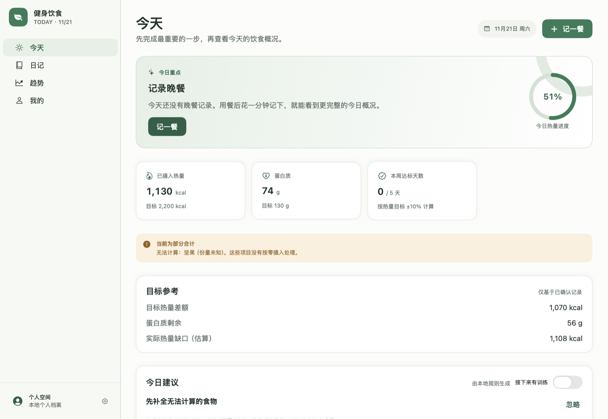
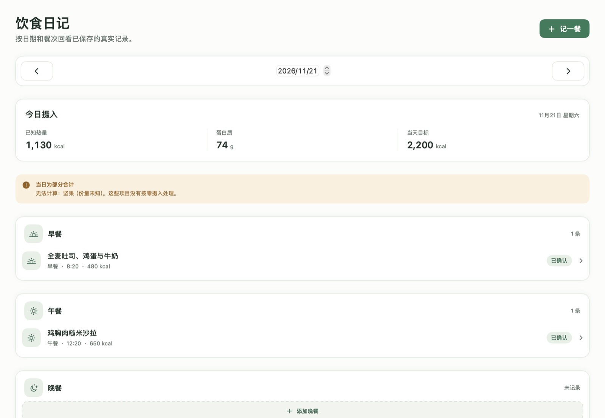
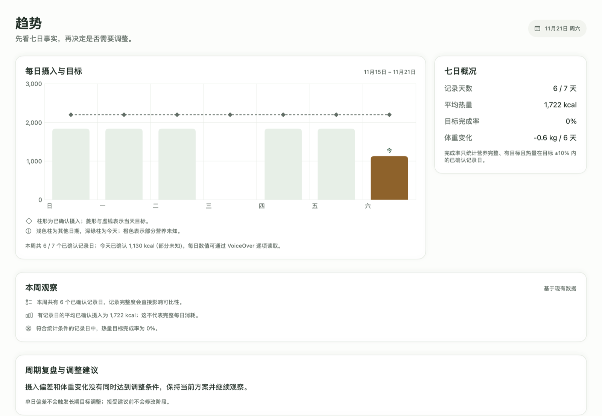

<div align="center">

# 健身饮食 · DietApp

**一个本地优先的 macOS 健身饮食记录与营养追踪应用。**

用自然语言或照片记录一餐；AI 只生成待确认的候选结果，营养计算与数据保存留在本机，最终由你确认后写入。


[](LICENSE)



</div>

## 项目简介

DietApp 面向增肌、减脂、维持和休息／恢复阶段的日常饮食管理。它不把 AI 识别结果直接当成最终数据，而是将文本或照片转换为结构化草稿，再由用户修正份量、营养和餐别后确认保存。

> **核心原则：模型负责提取候选信息，本地负责计算与保存，用户负责最终确认。**

这带来三个直接结果：

- **可解释**：保留原始输入、估算依据、缺失信息和用户修正，而不是只显示一个不可追溯的热量数字。
- **本地优先**：档案、饮食记录、目标和图片默认保存在本机，不接入云同步、广告或行为统计。
- **不制造精确感**：份量未知时显示范围或缺失状态，不把无法计算的营养值当作 `0`。

## 核心功能

- **个人档案与健身阶段**：记录身体信息、活动水平、饮食偏好、忌口和过敏食物；支持增肌、减脂、维持及休息／恢复阶段，并保留历史目标。
- **自然语言记录**：用一句话描述一餐，生成食物候选项、份量估算和营养草稿，再进入确认流程。
- **图片记录**：从文件或剪贴板导入食物图片，本地保存原图，并生成压缩 JPEG 上传副本；识别仍复用同一确认页。
- **识别与估算透明**：支持失败重试、补充信息、手动回退、食物拆分、份量及营养修正。
- **营养与目标计算**：在本地计算克、毫升和份的营养；使用 Mifflin–St Jeor 与活动系数生成目标建议，用户确认后保存。
- **饮食日记**：按日期和餐次查看记录及每日汇总；已有记录可以编辑、重新确认或删除。
- **七日趋势**：展示每日摄入、目标参考、记录完整度和体重变化，避免用单日波动推断长期趋势。
- **推荐与复盘**：根据本地规则生成饮食改善建议，并在周期复盘中提出待确认的目标调整。
- **桌面体验**：原生 macOS 侧栏、宽窄窗口自适应布局、浅色／深色主题和可访问语义。

## 记录流程

1. 选择餐别和时间，输入一段文字或导入一张图片。
2. 用户主动发起请求，由所配置的 OpenAI 兼容模型返回结构化 JSON。
3. App 校验字段、单位、数值范围和缺失信息，必要时要求一次澄清。
4. 用户核对食物、份量、估算依据和营养值，可手动修改或补充。
5. 用户确认后，记录写入本机 SwiftData；未知营养继续显示为缺失，而不是 `0`。

只有用户点击分析时才会上传文本或图片。图片上传前会压缩为最长边 1600 px 的 JPEG，原始图片仍保存在本机。

## 界面预览

| 饮食日记 | 七日趋势 |
| --- | --- |
|  |  |

截图使用合成数据，不包含真实个人记录。

## 快速开始

### 环境要求

- macOS 14 或更高版本
- 完整安装的 Xcode
- 可选：XcodeGen 2.4x，仅在需要从 `project.yml` 重新生成工程时使用

仓库已包含生成后的 `DietApp.xcodeproj`，通常可以直接打开。当前项目使用 Swift 5.9，并已在 Xcode 27.2 上完成 Debug 构建；如果工程版本无法打开，请升级 Xcode，或使用 XcodeGen 重新生成。

### 在 Xcode 中运行

```bash
# 从 GitHub 克隆或下载本仓库后，在仓库根目录执行
open DietApp.xcodeproj
```

1. 选择 `DietApp` scheme。
2. 运行目标选择 **My Mac**。
3. 本机开发可选择 **Sign to Run Locally**，不需要 Apple Developer 团队签名。

如果修改了 `project.yml` 或需要重新生成工程：

```bash
# 未安装 XcodeGen 时执行：brew install xcodegen
./Scripts/generate-project.sh
open DietApp.xcodeproj
```

<details>
<summary>命令行 Debug 构建</summary>

```bash
xcodebuild -project DietApp.xcodeproj \
  -scheme DietApp \
  -configuration Debug \
  -destination 'platform=macOS' \
  -derivedDataPath "$PWD/DerivedData" \
  CODE_SIGN_STYLE=Manual \
  CODE_SIGN_IDENTITY='-' \
  CODE_SIGNING_ALLOWED=YES \
  CODE_SIGNING_REQUIRED=NO \
  build
```

</details>

## 配置模型服务

打开应用后进入 **我的 → 模型设置**，填写：

- **Base URL**：兼容 OpenAI Chat Completions 的接口地址；可以填写到 `/v1`，也可以填写完整的 `/chat/completions` 地址。
- **模型名称**：供应商实际提供的模型 ID。
- **API Key**：仅保存在 macOS Keychain，不写入源码或普通设置文件。

图片记录需要所选供应商与模型支持 Chat Completions 多模态图片输入。设置页的“保存并用一个苹果测试”会发起一次真实请求，可能产生少量费用。

## 测试

```bash
# 默认测试：领域逻辑、SwiftUI 编译和纯数据图片导入
./Scripts/test.sh

# 额外启用 SwiftData 宏与持久化测试
./Scripts/test.sh --swiftdata
```

默认测试使用内存仓库，不访问真实剪贴板，也不调用真实模型供应商。测试脚本使用独立构建目录，避免与本地构建产物混用。

## 工程结构

```text
App/                       macOS App 入口与 Info.plist
Sources/DietCore/          领域模型、营养与目标引擎、LLM 客户端、持久化、图片和复盘
Sources/DietFeatures/      SwiftUI 页面、导航、设计系统与功能 ViewModel
Tests/                     DietCore 与 DietFeatures 的自动化测试
Scripts/                   工程生成与测试脚本
docs/                      产品、架构、UI、隐私和实施方案文档
project.yml                XcodeGen 工程描述
DietApp.xcodeproj          已生成的 Xcode 工程，可直接打开
```

### 技术栈

- Swift 5.9
- SwiftUI
- SwiftData
- Swift Package Manager
- XcodeGen
- macOS Keychain
- OpenAI 兼容 Chat Completions API

架构上将不依赖具体 UI 或数据库的业务规则放在 `DietCore`，将桌面界面放在 `DietFeatures`。默认 SwiftPM 测试使用内存仓库；macOS App 通过 `DIETAPP_SWIFTDATA` 编译条件启用相同领域模型上的 SwiftData 持久化。

## 隐私与安全

- 身体数据、饮食记录、目标和图片默认仅保存在本机。
- 不接入广告、第三方行为统计或默认遥测，也不包含云同步。
- 只有用户主动发起分析时，相关文本或压缩图片才发送给其配置的模型供应商。
- API Key 使用 Keychain 保存，不写入源码、普通偏好字段、日志或剪贴板。
- 只有用户执行粘贴时才读取剪贴板，不监听剪贴板变化。
- 所有外部响应都按不可信输入处理，并校验结构、类型、单位和数值范围。

本项目是个人饮食记录与估算工具，不是医疗设备，不提供诊断或治疗建议。模型估算可能不准确，营养数据应优先以包装标签、实际称重或专业来源为准。

## 当前状态

当前处于 **MVP 开发阶段**，核心记录、计算、日记、趋势和复盘流程已可运行。发布或公开分发前仍需完成：

- 真实模型供应商的文本与图片端到端验收
- 应用重启后的 SwiftData 和 Keychain 持久化验收
- 本地通知、完整键盘导航和 VoiceOver 人工验收
- Developer ID 签名、公证与正式分发流程
- 数据导出和备份恢复

详细验证边界见 [实施状态与验证说明](docs/implementation-status.md)。

## 设计文档

- [产品范围与核心场景](docs/superpowers/specs/diet-app/01-product-scope.md)
- [技术架构](docs/superpowers/specs/diet-app/02-architecture.md)
- [数据模型](docs/superpowers/specs/diet-app/03-data-model.md)
- [隐私、安全与可靠性](docs/superpowers/specs/diet-app/12-privacy-reliability.md)
- [测试与交付](docs/superpowers/specs/diet-app/13-testing-delivery.md)
- [macOS 桌面版迁移设计](docs/superpowers/specs/diet-app/14-macos-desktop.md)
- [完整设计索引](docs/superpowers/specs/diet-app/2026-11-10-diet-app-design.md)

## 许可证

本项目采用 [MIT License](LICENSE)。

Copyright (c) 2026 Yuzhao
